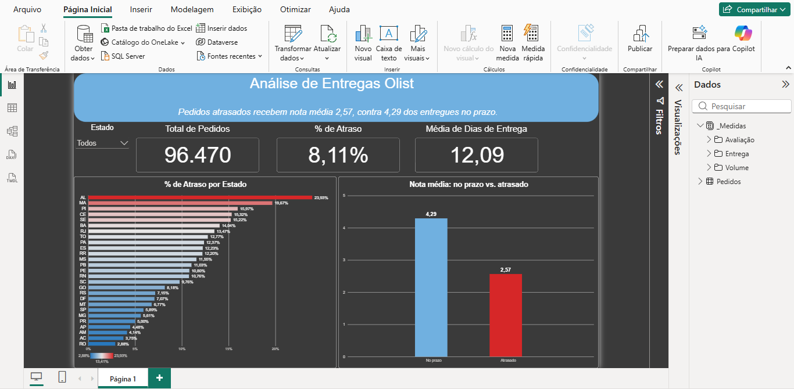

# Análise de Entregas Olist

Projeto de análise de dados com **Excel (Power Query)** e **Power BI** sobre atrasos nas entregas de um marketplace brasileiro e o impacto na avaliação dos clientes.



## Problema de negócio

> Onde e quanto a Olist atrasa nas entregas, e isso afeta a nota do cliente?

## Principais resultados

| Indicador | Valor |
|---|---|
| Pedidos analisados | 96.470 |
| Pedidos entregues com atraso | 8,11% |
| Tempo médio de entrega | 12,09 dias |
| Nota média (entregue no prazo) | 4,29 |
| Nota média (entregue com atraso) | 2,57 |

### Insights

- **8,11%** dos pedidos entregues chegaram depois da data estimada.
- Os maiores percentuais de atraso estão no Nordeste: **AL (23,93%)**, **MA (19,67%)** e **PI (15,97%)**. Os menores foram **RO (2,88%)**, **AC (3,75%)** e **AM (4,14%)**.
- Pedidos atrasados recebem nota média de **2,57**, contra **4,29** dos entregues no prazo. O atraso está **associado** a avaliações bem menores, mas esta análise não prova que ele seja a única causa da nota baixa.

## Base de dados

[Brazilian E-Commerce Public Dataset by Olist](https://www.kaggle.com/datasets/olistbr/brazilian-ecommerce) (Kaggle), com pedidos feitos entre 2016 e 2018.

Tabelas utilizadas:

| Arquivo | Uso |
|---|---|
| `olist_orders_dataset.csv` | Pedidos, status e datas (compra, entrega e prazo estimado) |
| `olist_customers_dataset.csv` | Estado do cliente |
| `olist_order_reviews_dataset.csv` | Nota da avaliação (1 a 5) |

Os arquivos originais não estão neste repositório. Veja a pasta [`dados`](dados/) para saber como baixá-los.

## Ferramentas

- **Excel (Power Query):** importação, limpeza, transformação e junção das tabelas
- **Power BI Desktop:** medidas em DAX e dashboard

## Etapas do projeto

1. Importação dos 3 arquivos CSV no Power Query.
2. Seleção das colunas necessárias e conversão das datas para Data/Hora.
3. Filtro de pedidos com status `delivered` e remoção dos pedidos sem data de entrega.
4. Criação das colunas `dias_entrega` e `atrasou` (1 = atrasado, 0 = no prazo).
5. Agrupamento das avaliações por pedido (média da nota), porque alguns pedidos têm mais de uma avaliação.
6. Junção das tabelas (pedidos + clientes + avaliações).
7. Conferência dos números com tabela dinâmica.
8. Criação do dashboard no Power BI com medidas (`Total de Pedidos`, `% de Atraso`, `Média de Dias de Entrega`, `Nota Média`).

## Metodologia

- **Pedidos considerados:** somente com status `delivered` e data de entrega preenchida.
- **Atraso:** pedido entregue depois da data estimada de entrega (comparação com data e hora).
- **Tempo de entrega:** tempo decorrido, em dias, entre a compra e a entrega ao cliente.
- **Nota:** média das avaliações do pedido, quando há mais de uma.

## Estrutura do repositório

```
olist-analise-entregas/
├── README.md
├── dados/          # como obter a base (Kaggle)
├── excel/          # planilha com o tratamento no Power Query
├── powerbi/        # arquivo do dashboard (.pbix)
└── imagens/        # print do dashboard
```

## Como abrir os arquivos

1. Baixe a base no Kaggle e salve os CSVs em uma pasta local.
2. Abra `excel/olist_entregas.xlsx`. Se o Excel pedir, atualize o caminho dos CSVs em **Dados → Obter Dados → Configurações da fonte de dados**.
3. Abra `powerbi/olist_entregas.pbix` no Power BI Desktop.

## Limitações

- Foram analisados apenas pedidos entregues. Pedidos cancelados ou em andamento ficaram de fora.
- Estados com poucos pedidos podem ter percentuais de atraso mais instáveis.
- A análise mostra associação entre atraso e nota, não causalidade.

## Autora

**Beatriz Cristina Feijó**
[LinkedIn](https://www.linkedin.com/in/beatriz-cristina-feijo)
